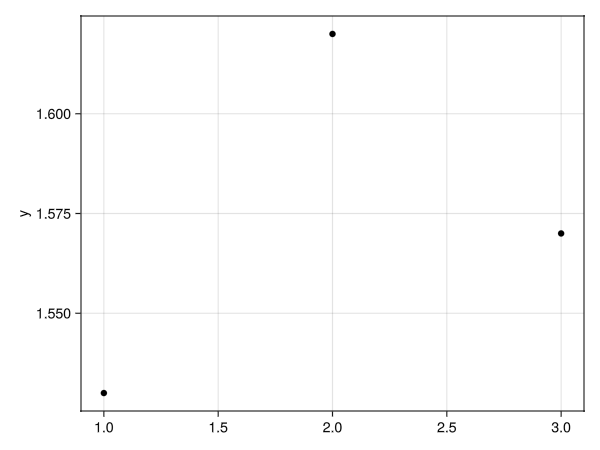
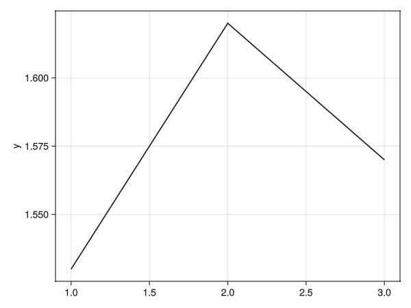
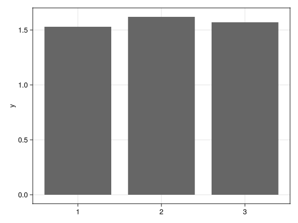
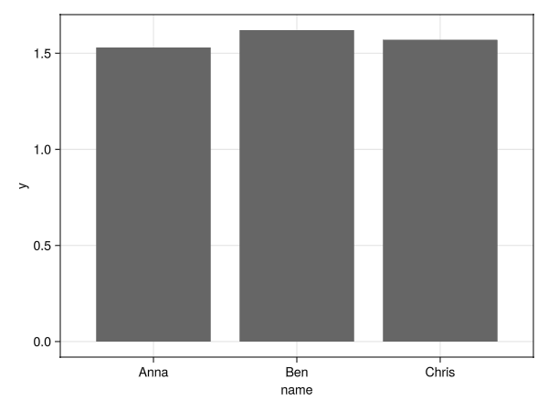
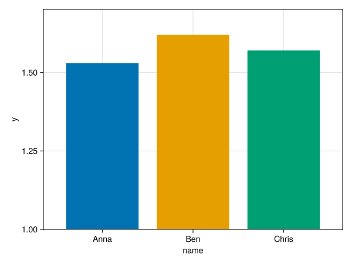
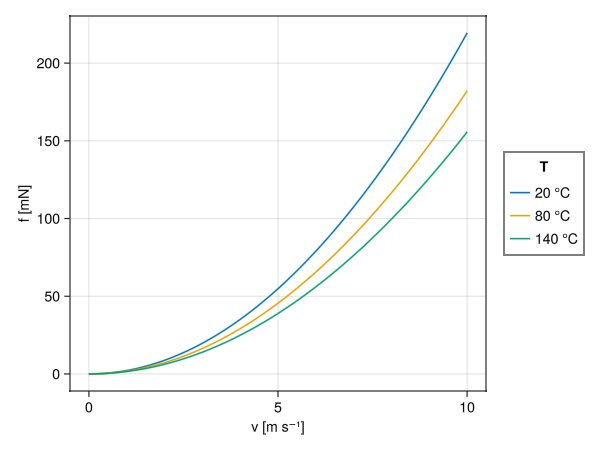
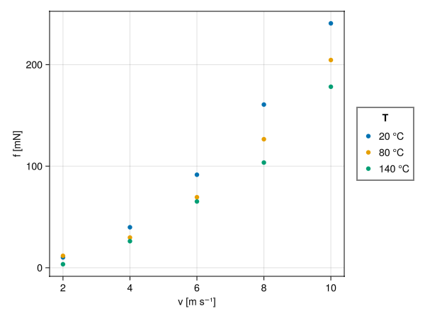
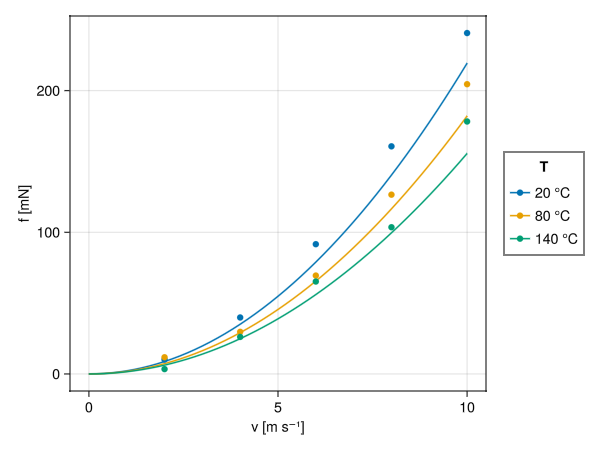
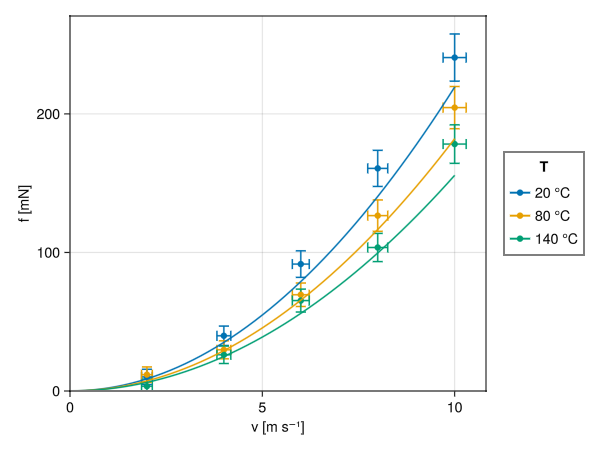

# Introduction to AlgebraOfGraphics (AoG)

`CasualPlots.jl` uses `AoG` under the hood, and the standalone scripts it generates also use `AoG`. To customize a generated script, you need a working grasp of `AoG` basics.

`AoG` builds plots by combining layers (`data * mapping * visual`). While the underlying logic is straightforward once understood, the official documentation is geared toward statistical and observational data analysis, which can make the initial learning curve steep for experimental scientists and engineers who mainly need standard 2D `Scatter`, `Lines`, and `BarPlot` figures. This chapter introduces `AoG` from that perspective, starting from a single vector and building up to multi-layer plots with physical units and error bars.

## Other Manuals and Tutorials

For further reading and comprehensive reference, see:

- [Official AlgebraOfGraphics.jl Documentation](https://aog.makie.org/stable/)
- [Exploratory Data Analysis with Makie (Using Julia)](https://jverzani.github.io/UsingJ/EDA/makie.html)
- [Pumas Tutorials: Introduction to AlgebraOfGraphics](https://tutorials.pumas.ai/html/PlottingInJulia/01-AoG-intro.html)
- [Pumas Tutorials: The Grammar of AlgebraOfGraphics](https://tutorials.pumas.ai/html/PlottingInJulia/05-AoG-Grammar.html)

## Simple Plots from a Vector

Let's start with the simplest dataset — a one-dimensional array of data — and see how we can visualize it in different ways.

### Scatter Plot

The common way to visualize individual data points is a Scatter Plot.

```julia
using WGLMakie, AlgebraOfGraphics, DataFrames

d01 = (; y=[1.53, 1.62, 1.57])
fg1s = data(d01) * mapping(:y) * visual(Scatter) |> draw
```

This code creates a scatter plot of the `y` values. The `data` function specifies the data source, `mapping` determines how data components are mapped to visual properties of the plot (in this case, the `y` axis), and `visual` specifies the type of plot.



### Lines Plot

To see the trend between the data points, we can use a line plot.

```julia
fg1l = data(d01) * mapping(:y) * visual(Lines) |> draw
```



### Bar Plot

A bar plot is useful for comparing values.

```julia
fg1b = data(d01) * mapping(:y) * visual(BarPlot) |> draw
```



## Mapping Categorical Data

Now, let's add some categorical data to our plots.

### Bar Plot with Categories

We can map a categorical variable to the x-axis to create a bar plot with named bars.

```julia
d02 = (; y=[1.53, 1.62, 1.57], name=["Anna", "Ben", "Chris"])
fg2b = data(d02) * mapping(:name, :y) * visual(BarPlot) |> draw
```



### Colored Bar Plot

We can also use the categorical variable to color the bars.

```julia
plt2 = data(d02) * mapping(:name, :y; color=:name) * visual(BarPlot)
fg2bc = draw(plt2; legend=(show=false, ), axis=(limits=(nothing, nothing, 1.0, nothing),));
```

Here, we also adjusted the axis limits and hid the legend for a cleaner look.



## Working with Real Data: Air Drag Example

This section demonstrates more advanced AlgebraOfGraphics features using a realistic example: comparing theoretical air drag force calculations with experimental measurements. It also showcases how AlgebraOfGraphics seamlessly handles physical units using `Unitful.jl`, automatically labeling axes with the correct units. The air drag force on a sphere depends on velocity and temperature, which are our experimental variables. We'll progressively build up a complex multi-layer plot to show both theoretical predictions and measured data with error bars.

### Theoretical Data: Line Plots with Grouping

First, we calculate theoretical force values across a range of velocities at three different temperatures (20°C, 80°C, 140°C):

!!! details "Create data"
    ```julia
    using WGLMakie, AlgebraOfGraphics, DataFrames, Unitful

    f_theor(v; T=25u"°C", d=10u"cm^2", Cp=0.47) = (13.6816e5u"(kg*K)/m^5" * Cp * v^2 * d^2 / (T |> u"K")) |> u"mN"

    Tc = collect(20:60.0:140) .* u"°C"
    V = (0:0.2:10) .* u"m/s"

    df = DataFrame([
        (; v, T=t, f=f_theor(v; T=t))
        for v in V for t in Tc
    ])
    ```


The resulting DataFrame has one row for each velocity-temperature combination:

```
153×3 DataFrame
 Row │ v           T          f            
     │ Quantity…   Quantity…  Quantity…    
─────┼─────────────────────────────────────
   1 │  0.0 m s⁻¹      20 °C        0.0 mN
   2 │  0.0 m s⁻¹      80 °C        0.0 mN
   3 │  0.0 m s⁻¹     140 °C        0.0 mN
   4 │  0.2 m s⁻¹      20 °C        0.08 mN
  ⋮  │     ⋮           ⋮           ⋮
 152 │ 10.0 m s⁻¹      80 °C    182.09 mN
 153 │ 10.0 m s⁻¹     140 °C    155.64 mN
```

Now we create a line plot with separate curves for each temperature using the `group` keyword:

```julia
plt1 = data(df) * mapping(:v, :f; group=:T, color=:T => nonnumeric) * visual(Lines) 
fig1 = plt1 |> draw
```

The `color=:T => nonnumeric` transformation tells AlgebraOfGraphics to treat temperature as a categorical variable for marker (in this case, line) colors.



### Measured Data: Transforming from Wide to Long Format

Experimental measurements are often stored in a ["wide" format](https://aog.makie.org/stable/examples/data-manipulations/wide-data#Long-vs-Wide-Data-Formats). Here, data for each temperature are in a separate column. 

!!! details "Create data"
    ```julia
    # Measured data at discrete velocities
    vs = (2:2:10) .* u"m/s"
    f_measured = [
        10.17 11.78 3.43; 
        39.86 29.74 26.15; 
        91.6 69.46 65.26; 
        160.67 126.57 103.57; 
        240.65 204.54 178.22
        ] .* u"mN"

    m = hcat(vs, f_measured)
    Ts = (T .|> string)
    nms = vcat("v", Ts) # column names 
    dfm = DataFrame(m, nms)
    ```


The wide-format DataFrame looks like this:

```
5×4 DataFrame
 Row │ v           20         80         140       
     │ Quantity…   Quantity…  Quantity…  Quantity… 
─────┼─────────────────────────────────────────────
   1 │  2.0 m s⁻¹   10.17 mN   11.78 mN    3.43 mN
   2 │  4.0 m s⁻¹   39.86 mN   29.74 mN   26.15 mN
   3 │  6.0 m s⁻¹    91.6 mN   69.46 mN   65.26 mN
   4 │  8.0 m s⁻¹  160.67 mN  126.57 mN  103.57 mN
   5 │ 10.0 m s⁻¹  240.65 mN  204.54 mN  178.22 mN
```

AlgebraOfGraphics works best with "long" format data, so let's convert the data to long format using `stack`:

!!! details "Convert table, add error values"
    ```julia
    dfl = stack(dfm, Ts; value_name=:f, variable_name=:T)

    # convert T into numeric unitful data
    transform!(dfl, :T => ByRow(s -> parse(Int, s)*u"°C") => :T)

    # Add error estimates
    dfl[!, :f_err] = @. 5u"mN" + dfl[!, :f] * 0.05
    dfl[!, :v_err] = @. 0.1u"m/s" + dfl[!, :v] * 0.02
    ```

    **What just happened?** 
    - `stack(dfm, Ts; value_name=:f, variable_name=:T)` takes the three temperature columns (`"20"`, `"80"`, `"140"`) and "stacks" them into two new columns: `T` (containing the column name) and `f` (containing the data)
    - `transform!` converts temperature from strings back to integers and then to `°C`
    - We then add error estimates for both force and velocity measurements


The transformed long-format DataFrame with error columns:

```
 Row │ v           T          f          f_err      v_err      
     │ Quantity…   Quantity…  Quantity…  Quantity…  Quantity…  
─────┼─────────────────────────────────────────────────────────
   1 │  2.0 m s⁻¹      20 °C   10.17 mN    5.51 mN  0.14 m s⁻¹
   2 │  4.0 m s⁻¹      20 °C   39.86 mN    6.99 mN  0.18 m s⁻¹
   3 │  6.0 m s⁻¹      20 °C    91.6 mN    9.58 mN  0.22 m s⁻¹
   4 │  8.0 m s⁻¹      20 °C  160.67 mN   13.03 mN  0.26 m s⁻¹
  ⋮  │     ⋮           ⋮          ⋮          ⋮          ⋮
  14 │  8.0 m s⁻¹     140 °C  103.57 mN   10.18 mN  0.26 m s⁻¹
  15 │ 10.0 m s⁻¹     140 °C  178.22 mN   13.91 mN   0.3 m s⁻¹
```

Now we can create a scatter plot. 

```julia
plt2 = data(dfl) * mapping(:v, :f; color=:T => nonnumeric) * visual(Scatter) 
fig2 = plt2 |> draw
```



### Layering: Combining Multiple Plot Types

One of AlgebraOfGraphics' most powerful features is the ability to layer different plot types. We can combine our theoretical lines with the measured scatter points using the `+` operator:

```julia
fg12 = (plt1 + plt2) |> draw
```

This creates a single plot showing both datasets, making it easy to compare theory with experiment.



### Advanced Layering: Error Bars and Custom Scales

Finally, we add error bars in both x and y directions. To avoid cluttering the legend, we use a named scale `:err` for the error bars so we can hide them:

```julia
# Y-direction error bars
plt3 =  data(dfl) * 
        mapping(:v, :f, :f_err; color = :T => nonnumeric => scale(:err)) * 
        visual(Errorbars; whiskerwidth = 10)

# X-direction error bars
plt4 =  data(dfl) * 
        mapping(:v, :f, :v_err; color=:T => nonnumeric => scale(:err)) * 
        visual(Errorbars; whiskerwidth = 10, direction = :x)

# Combine all layers with custom axis settings
fg1234 = draw(plt4 + plt3 + plt2 + plt1, 
    scales(; err = (; legend = false));
    axis = (; limits = (0, nothing, 0, nothing))
    )
```

Key features demonstrated here:

- **Named scales**: `scale(:err)` creates a custom scale identifier. Here, because it is passed to the `color` mapping, AoG assigns it to an independent color scale that can be configured separately.
- **Scale configuration**: `scales(; err = (; legend = false))` hides the legend for the `:err` scale
- **Axis customization**: `limits = (0, nothing, 0, nothing)` sets both axes to start at 0 while letting the maximum values be determined automatically
- **Layer ordering**: Layers are drawn in the order they appear (plt4 → plt3 → plt2 → plt1), so error bars appear behind the data points



This final plot combines four layers: theoretical lines, measured points, and error bars in both directions, creating a presentation-ready figure.
