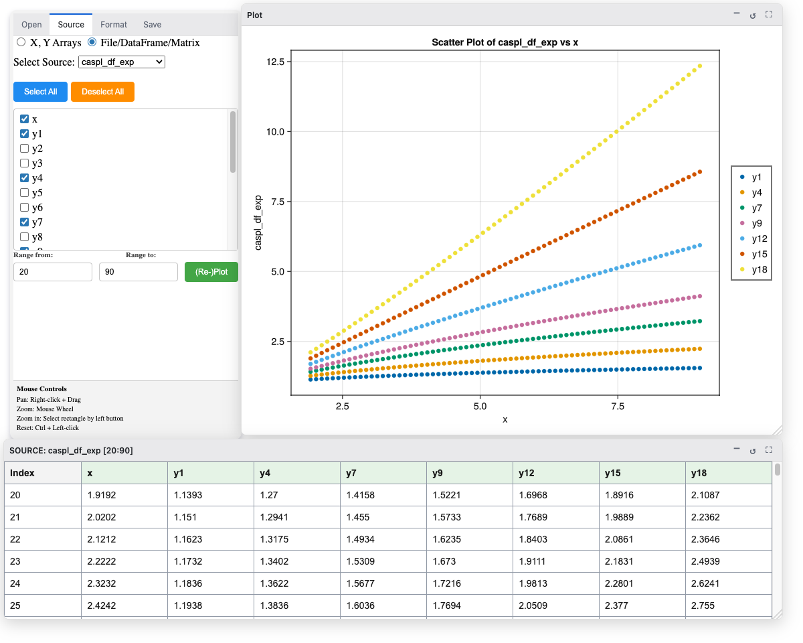

[](https://opensource.org/licenses/MIT)
[](https://eben60.github.io/CasualPlots.jl/) 
[](https://github.com/Eben60/CasualPlots.jl/actions?query=workflow%3ACI) 
[](https://github.com/JuliaTesting/Aqua.jl)


# CasualPlots.jl

`CasualPlots.jl` is a GUI-based plotting application for Julia. It is positioned in the middle ground between purely script-based plotting and standalone GUI plotting tools. 

The package is intended for experimental scientists, engineers, and casual Julia users who require fast visual exploration of 2D data without having to memorize syntax for common plot customizations.

**What it is not**: In no way is the intention to compete with any “serious” tools in terms of feature scope – not with standalone behemoths like commercial [Origin](https://www.originlab.com/) or free [Veusz](https://veusz.github.io/), nor with Julia graphic packages like [Makie.jl](https://github.com/MakieOrg/Makie.jl) or [Plots.jl](https://github.com/juliaplots/plots.jl).

The main feature of `CasualPlots.jl` is the combination of a GUI for data visualization, both as table and plot, with direct access to the variables in the Julia REPL session. Once you create and format a plot, it can be saved, or CasualPlots can generate a standalone Julia script that reproduces the exact visualization. You can then polish that script to produce a publication-ready figure or integrate the code directly into a data processing pipeline.

!!! details "📸 Screenshot: Plotting data from a DataFrame"
    *🔍 [Click to view full resolution](Screenshots/dataframe_source_selection.png)*
    [](Screenshots/dataframe_source_selection.png)


## Features

- **Data Sources**:
  - Julia `Main` workspace variables (1D Vectors, Matrices, and DataFrames). [Unitful](https://github.com/JuliaPhysics/Unitful.jl) data are welcome
  - External files on disk in CSV/TSV and XLSX format.
- **Plot Types**:   
  - Common 2D plot types: Scatter, Lines, Line+Symbol, and BarPlot (supporting vertical or horizontal orientation, and dodged or stacked modes).
  - Dataset grouping by color or geometry (marker shape or line style).
- **Data Table Representation**: Displays the active dataset in a scrollable table. 
- **Script Generation**: Generates standalone Julia scripts replicating plots configured in the GUI using `AlgebraOfGraphics` and `Makie`.
- **Saving Plots**: Exports static figures directly from the GUI as PNG, SVG, or PDF. 

## Software Stack

- **GUI**: [Bonito.jl](https://github.com/SimonDanisch/Bonito.jl) and [BonitoWidgets.jl](https://github.com/SimonDanisch/BonitoWidgets.jl).
- **Plotting Pipeline**: [AlgebraOfGraphics.jl](https://github.com/MakieOrg/AlgebraOfGraphics.jl) (commonly abbreviated to `AoG`), and [Makie.jl](https://github.com/MakieOrg/Makie.jl) (`WGLMakie.jl` for interactive display and `CairoMakie.jl` for file export).

## How To Use

### Installation

`CasualPlots.jl` is a registered package. It requires Julia v1.10 or higher.

!!! note
    Because the package pulls in roughly 300 transitive dependencies, avoid installing it into your default global environment to prevent potential version conflicts.

```julia-repl
# Not recommended:

(@v1.13) pkg> add CasualPlots
```

Instead, it is better to install it directly into your project environment/workspace. Alternatively, install it into a shared environment and load it anywhere using [ShareAdd.jl](https://github.com/Eben60/ShareAdd.jl):

```julia-repl
julia> using ShareAdd

julia> @usingany CasualPlots
```

`@usingany` loads the package from any shared environment if found. If not, it first prompts to install it into a shared environment of your choice.

### Launching the GUI

`CasualPlots.jl` creates a Bonito GUI application that can display in a standalone [Electron.jl](https://github.com/JuliaGizmos/Electron.jl) window, a web browser, or the VS Code plot pane.

#### Default Display (which may be plot pane or browser)

```julia-repl
julia> using CasualPlots

julia> app = casualplots_app()

julia> display(app)

julia> close(app)  # close the app when finished
```

#### Serving to a Web Browser

```julia-repl
using Bonito
julia> app = casualplots_app()

julia> server = Bonito.Server(app, "127.0.0.1", 8000)
Server:
  isrunning: true
  listen_url: http://localhost:8000
  online_url: http://localhost:8000
  http routes: 1
    / => App
  websocket routes: 0
```

Open a browser and navigate to `http://localhost:8000` (or the fallback port shown in the terminal message if port 8000 is occupied).

#### Standalone Electron Window

```julia-repl
julia> app = casualplots_app()

julia> Ele.serve_app(app)
```

The author prefers Electron when using the package.

See usage/testing examples in the scripts in the `src/scripts` folder of the package.

!!! note
    - **External Files (CSV and XLSX)**: File import uses package extensions, so you must run `using CSV` and/or `using XLSX` *before* starting the GUI if you plan to load files from disk.
    - **TTFP**: Even on a fast computer, there may be a noticeable delay on first plot creation, colloquially known to Julia users as the "Time To First Plot" (TTFP). Please be patient on the first use. Subsequent replotting is fast.

For a complete walkthrough of selecting data, formatting plots, customizing live figures from the REPL, and exporting plots or scripts, see:
- **[Tutorial](tutorial.md)** — Step-by-step guide to all GUI tabs and workflows.
- **[Script Generation](script_generation.md)** — How to generate and customize standalone Julia plotting scripts.
- **[Introduction to AlgebraOfGraphics](aog_intro.md)** — A practical guide to `AlgebraOfGraphics.jl` for customizing generated scripts.

## Exported and Selected Public Variables

For the full list, see the API section

### Exported Entities

```@autodocs; canonical = false
Modules = [CasualPlots]
Order   = [:function, :macro, :type]
Filter = t -> Base.isexported(CasualPlots, Symbol(t))
```

### Public Entities 

```@docs; canonical = false
CasualPlots.last_error
CasualPlots.@populate
Ele.serve_app
```

## Miscellaneous

### 👍Likes & 👎dislikes?

```@raw html
<p>Star on <a href="https://github.com/Eben60/CasualPlots.jl">GitHub</a> (that one is <span style="color: red; font-weight: bold;">important</span>!), open an issue, or contact <a href="https://discourse.julialang.org/u/eben60/summary">me</a> on Julia Discourse.</p>
```

### AI usage disclosure

Google [Antigravity](https://antigravity.google/) was used extensively for coding and documentation under the author's supervision.

### Copyright and License

© 2025-2026 Ben Elkin (Eben60)

Released under the MIT License (see the `LICENSE` file for details).
