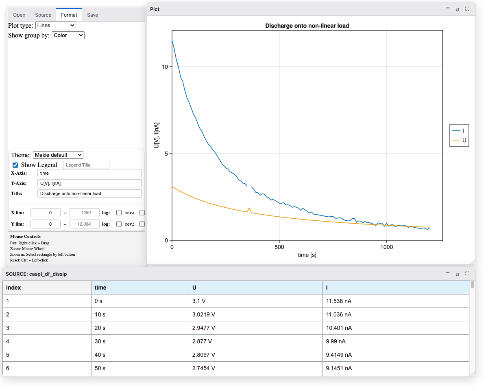
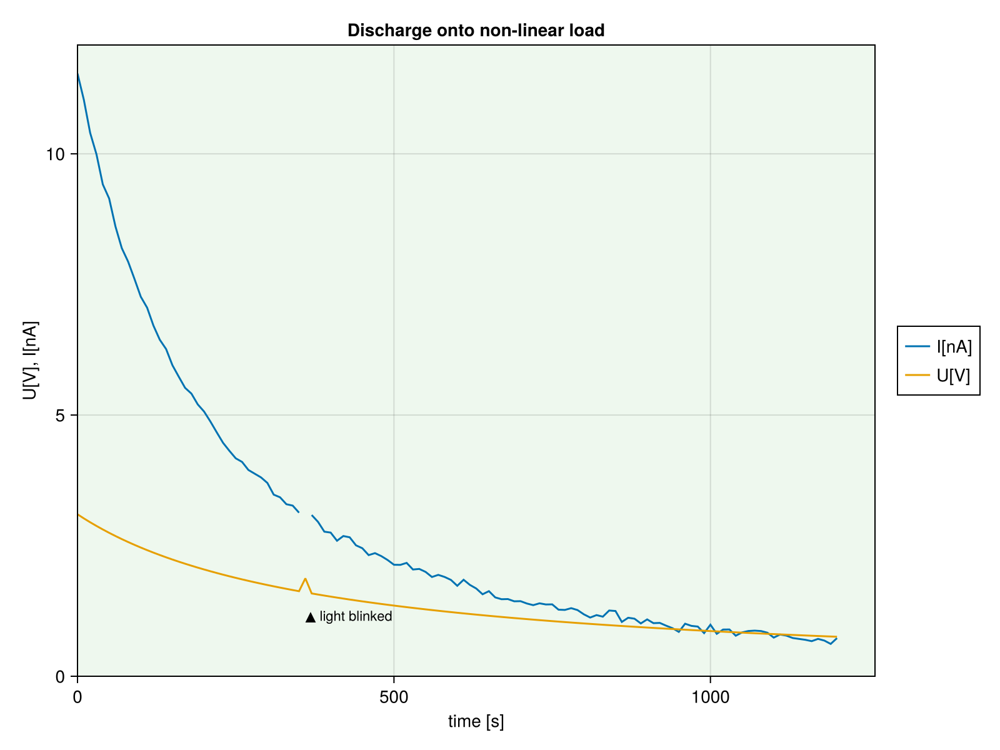

# Script Generation

`CasualPlots.jl` includes an automatic script generation module that translates the current GUI configuration into standalone Julia code. The generated script operates independently of the CasualPlots GUI, utilizing [`AlgebraOfGraphics.jl`](https://github.com/MakieOrg/AlgebraOfGraphics.jl) and [`Makie.jl`](https://github.com/MakieOrg/Makie.jl) directly, while relying on a few helper functions provided by `CasualPlots.jl`.

## Purpose

Script generation is particularly useful for:
* **Reproducibility**: Saving the exact configuration of a plot for future reference.
* **Advanced Customization**: Providing a starting point to apply final polishes or customizations not available within the GUI to produce publication-quality plots.
* **Automation**: Integrating the generated code directly into data processing pipelines or larger scripts.

## Generating Code from the GUI
1. Configure your dataset and plot settings in the GUI.
2. Navigate to the **Save** tab.
3. Specify a file path in the **File Path** input field (e.g., `my_plot_script.jl`), or click **Select File...** to browse your filesystem.
4. Click **Create Script** to generate the Julia code and save it directly to the specified file.

---

## Structure of Generated Code

The generated code consists of three main components:

1. **`cp_load_data(...)`**: If necessary loads data from disk, extracts and cleans the source data, applying specified rows and columns subsetting. Returns the data as DataFrame in the "wide" form.
2. **`cp_create_plot(plot_data)`**: Converts the DataFrame into the "tall" form, constructs the `AlgebraOfGraphics` pipeline, sets themes, applies mappings, and returns the figure object.
3. **Execution Block**: Provides commented-out examples for displaying the figure or saving it to PNG, SVG, or PDF formats.

---

## Example: Plot of Capacitor Discharge

The following walkthrough demonstrates how to produce and subsequently customize a script. We use sample data simulating a discharge of a capacitor onto a non-linear load, plotting voltage ($U$) and current ($I$) against time. The source DataFrame also has a `"remarks"` column containing a single non-missing entry, which we will initially ignore.

###     

1. Launch the application and populate demo data:
   ```julia
   using CasualPlots
   CasualPlots.@populate 
   app = casualplots_app()
   Ele.serve_app(app);
   ```
2. In the **Source** tab:
   - Select **DataFrame** as the Source Type.
   - Choose `caspl_df_dissip` from the **Select Source:** dropdown.
   - Click **Select All**, then uncheck column `remarks`.
   - Click **(Re-)Plot** (and dismiss the physical dimensions mismatch warning modal when prompted).
3. In the **Format** tab:
   - Ensure **Plot type:** is set to `Lines` and **Show group by:** to `Color`.
   - Ensure **Show Legend** is checked.
   - Leave **X-Axis:** as `time`.
   - Set **Y-Axis:** to `U[V], I[nA]`.
   - Set **Title:** to `Discharge onto non-linear load`.
   - Under **X lim:**, enter `0` as the lower limit.
   - Under **Y lim:**, enter `0` as the lower limit.
4. Generate the script following the instructions in [Generating Code from the GUI](#generating-code-from-the-gui) above (navigate to the **Save** tab, specify the file path, and click **Create Script**).

!!! details "📸 Screenshot: Discharge onto Non-Linear Load Plot"
    *🔍 [Click to view full resolution](Screenshots/non-linear-discharge.png)*
    [](Screenshots/non-linear-discharge.png)

### Generated Script

!!! details "📜 Generated Script"
    ```julia
    # Auto-generated by CasualPlots.jl
    using DataFrames
    using WGLMakie
    using AlgebraOfGraphics
    using CasualPlots
    # # --- uncomment next line for high quality static output, esp. for saving ---
    # using CairoMakie

    function cp_load_data(; data = caspl_df_dissip,
        # rows: rows range to plot. Examples: (:begin, :end), (1, 100), (:begin, 10), (10, :end)
        rows = (:begin, :end),
        )

        @assert length(rows) == 2 &&
            (rows[1] isa Integer || rows[1] == :begin) &&
            (rows[2] isa Integer || rows[2] == :end)

        # Assuming caspl_df_dissip is available in the executing environment
    # 121×4 DataFrame
    #  Row │ time        U           I            remarks
    #      │ Quantity…?  Quantity…?  Quantity…?   String?
    # ─────┼──────────────────────────────────────────────
    #    1 │      0.0 s       3.1 V   11.5378 nA  missing
    #    2 │     10.0 s   3.02193 V   11.0363 nA  missing
    #    3 │     20.0 s    2.9477 V   10.4015 nA  missing
    #    4 │     30.0 s   2.87703 V   9.99002 nA  missing
    #    5 │     40.0 s   2.80967 V   9.41493 nA  missing
    #    6 │     50.0 s   2.74539 V   9.14506 nA  missing
    #    7 │     60.0 s   2.68398 V   8.60835 nA  missing
    #    8 │     70.0 s   2.62526 V   8.19418 nA  missing
    #   ⋮  │     ⋮           ⋮            ⋮          ⋮
    #  115 │   1140.0 s  0.785805 V  0.714534 nA  missing
    #  116 │   1150.0 s  0.780693 V  0.697325 nA  missing
    #  117 │   1160.0 s  0.775646 V  0.671721 nA  missing
    #  118 │   1170.0 s  0.770665 V  0.715101 nA  missing
    #  119 │   1180.0 s  0.765747 V  0.682911 nA  missing
    #  120 │   1190.0 s  0.760892 V  0.618702 nA  missing
    #  121 │   1200.0 s  0.756098 V  0.730415 nA  missing
    #                                     106 rows omitted
        @assert data isa AbstractDataFrame || data isa AbstractMatrix
        df = data isa AbstractMatrix ? DataFrame(data, [Symbol("caspl_df_dissip_$i") for i in 1:size(data, 2)]) : data
        df_selected = select(df, ["time", "U", "I"])
        if rows != (:begin, :end)
            if rows[1] == :begin
                df_selected = df_selected[begin:rows[2], :]
            elseif rows[2] == :end
                df_selected = df_selected[rows[1]:end, :]
            else
                df_selected = df_selected[rows[1]:rows[2], :]
            end
        end
        df_selected = CasualPlots.clean_plot_data!(df_selected, ["time", "U", "I"])
        return (; df=df_selected, x_name="time", y_name="caspl_df_dissip")
    end

    function cp_create_plot(plot_data)
        WGLMakie.activate!() # Or CairoMakie.activate!() for static output
        set_theme!()
        (; df, x_name, y_name) = plot_data
        ys = names(df)[2:end]
        x_col = Symbol(names(df)[1])
        y_col = :y
        group_col = :group
        df = stack(df, ys; variable_name=:group, value_name=:y)
        final_x_name = "time"
        final_y_name = "U[V], I[nA]"
        title = "Discharge onto non-linear load"
        plt = AlgebraOfGraphics.data(df) * mapping(x_col => final_x_name, y_col => final_y_name) * mapping(; color = group_col => "") * visual(Lines)
        
        limits = (0.0, nothing, 0.0, nothing)
        
        fg = draw(plt; 
            figure=(; size=(800, 600)), 
            legend=(show=true,), 
            axis=(; title, limits, xreversed=false, yreversed=false)
        )
        
        return fg
    end

    # Execution 
    #
    # uncomment and run the corresponding lines to generate, display, and/or save the plot
    #
    # # --- taking exactly the same data already existing in the Main --
    #
    # # For available kwargs (like `rows`), see the cp_load_data signature
    # plot_data = cp_load_data()
    # fg = cp_create_plot(plot_data)
    #
    # # --- or, specify your input data (here my_data) ---
    #
    # plot_data = cp_load_data(; data=my_data)
    # fg = cp_create_plot(plot_data)
    # 
    # display(fg)
    #
    # # --- in case not already done:  ---
    # using CairoMakie
    # CairoMakie.activate!()
    #
    # CairoMakie.save("U-vs-time.svg", fg) # saving as svg
    # CairoMakie.save("U-vs-time.pdf", fg) # saving as pdf
    # CairoMakie.save("U-vs-time.png", fg) # saving as png
    ;
    ```

---

## Customizing the Generated Script

The generated script serves as a starting point for further customizations that are not directly available through the GUI. By modifying the code, you can leverage the full power of both [`AlgebraOfGraphics.jl`](https://github.com/MakieOrg/AlgebraOfGraphics.jl) and [`Makie.jl`](https://github.com/MakieOrg/Makie.jl). Here, we limit ourselves to the following customizations:

1. Rename the units in the Legend
2. Change the backgroung color
3. Insert the comment(s) from the "remarks" column into the plot at the event time.

Furthermore, we switch to the static `CairoMakie` backend for optimal output quality.

The first two customizations are implemented directly within the `AlgebraOfGraphics` pipeline, whereas the annotation is added downstream on the resulting `Makie` figure.

!!! details "📜 Customized Script"
    ```julia
    # Auto-generated by CasualPlots.jl and customized
    using DataFrames
    using WGLMakie
    using AlgebraOfGraphics
    using CasualPlots
    using CairoMakie
    using Unitful: ustrip

    function cp_load_data(; data = caspl_df_dissip,
        # rows: rows range to plot. Examples: (:begin, :end), (1, 100), (:begin, 10), (10, :end)
        rows = (:begin, :end),
        )

        @assert length(rows) == 2 &&
            (rows[1] isa Integer || rows[1] == :begin) &&
            (rows[2] isa Integer || rows[2] == :end)

        # Assuming caspl_df_dissip is available in the executing environment
    # 121×4 DataFrame
    #  Row │ time        U           I            remarks
    #      │ Quantity…?  Quantity…?  Quantity…?   String?
    # ─────┼──────────────────────────────────────────────
    #    1 │      0.0 s       3.1 V   11.5378 nA  missing
    #    2 │     10.0 s   3.02193 V   11.0363 nA  missing
    #    3 │     20.0 s    2.9477 V   10.4015 nA  missing
    #    4 │     30.0 s   2.87703 V   9.99002 nA  missing
    #    5 │     40.0 s   2.80967 V   9.41493 nA  missing
    #    6 │     50.0 s   2.74539 V   9.14506 nA  missing
    #    7 │     60.0 s   2.68398 V   8.60835 nA  missing
    #    8 │     70.0 s   2.62526 V   8.19418 nA  missing
    #   ⋮  │     ⋮           ⋮            ⋮          ⋮
    #  115 │   1140.0 s  0.785805 V  0.714534 nA  missing
    #  116 │   1150.0 s  0.780693 V  0.697325 nA  missing
    #  117 │   1160.0 s  0.775646 V  0.671721 nA  missing
    #  118 │   1170.0 s  0.770665 V  0.715101 nA  missing
    #  119 │   1180.0 s  0.765747 V  0.682911 nA  missing
    #  120 │   1190.0 s  0.760892 V  0.618702 nA  missing
    #  121 │   1200.0 s  0.756098 V  0.730415 nA  missing
    #                                     106 rows omitted
        @assert data isa AbstractDataFrame || data isa AbstractMatrix
        df = data isa AbstractMatrix ? DataFrame(data, [Symbol("caspl_df_dissip_$i") for i in 1:size(data, 2)]) : data
        df_selected = select(df, ["time", "U", "I", "remarks"])
        if rows != (:begin, :end)
            if rows[1] == :begin
                df_selected = df_selected[begin:rows[2], :]
            elseif rows[2] == :end
                df_selected = df_selected[rows[1]:end, :]
            else
                df_selected = df_selected[rows[1]:rows[2], :]
            end
        end
        df_selected = CasualPlots.clean_plot_data!(df_selected, ["time", "U", "I", "remarks"])
        return (; df=df_selected, x_name="time", y_name="caspl_df_dissip")
    end

    function cp_create_plot(plot_data)
        CairoMakie.activate!()
        set_theme!()
        (; df, x_name, y_name) = plot_data
        
        # Extract non-missing remarks before stacking
        remarks_rows = filter(:remarks => !ismissing, df)

        # Rename columns to include units in legend labels
        df = rename(df, "U" => "U[V]", "I" => "I[nA]")
        ys = ["U[V]", "I[nA]"]
        
        x_col = Symbol(names(df)[1])
        y_col = :y
        group_col = :group
        df = stack(df, ys; variable_name=:group, value_name=:y)
        final_x_name = "time"
        final_y_name = "U[V], I[nA]"
        title = "Discharge onto non-linear load"
        plt = AlgebraOfGraphics.data(df) * mapping(x_col => final_x_name, y_col => final_y_name) * mapping(; color = group_col => "") * visual(Lines)
        
        limits = (0.0, nothing, 0.0, nothing)
        
        # Custom salad-green background color
        salad_green = "#eef8ee"
        
        fg = draw(plt; 
            figure=(; size=(800, 600)), 
            legend=(show=true,), 
            axis=(; title, limits, xreversed=false, yreversed=false, backgroundcolor=salad_green)
        )
        
        # Annotate remarks on the plot
        ax = fg.grid[1, 1].axis
        for r in eachrow(remarks_rows)
            t_val = Float64(ustrip(r.time))
            text!(ax, t_val, 1; text = "▲ $(r.remarks)", align = (:left, :bottom), fontsize = 11)
        end
        
        return fg
    end

    # Execution 
    #
    # uncomment and run the corresponding lines to generate, display, and/or save the plot
    #
    # --- taking exactly the same data already existing in the Main --

    # For available kwargs (like `rows`), see the cp_load_data signature
    plot_data = cp_load_data()
    fg = cp_create_plot(plot_data)
    #
    # # --- or, specify your input data (here my_data) ---
    #
    # plot_data = cp_load_data(; data=my_data)
    # fg = cp_create_plot(plot_data)
    # 
    display(fg)
    #
    # # --- in case not already done:  ---
    # using CairoMakie
    # CairoMakie.activate!()
    #
    # CairoMakie.save("U-vs-time.svg", fg) # saving as svg
    # CairoMakie.save("U-vs-time.pdf", fg) # saving as pdf
    # CairoMakie.save("U-vs-time.png", fg) # saving as png
    ;
    ```

!!! details "🔍 Script Full Diff (Initial vs. Customized Script)"
    ```diff
    --- initial_generated.jl
    +++ customized.jl
    @@ -1,10 +1,10 @@
    -# Auto-generated by CasualPlots.jl
    +# Auto-generated by CasualPlots.jl and customized
     using DataFrames
     using WGLMakie
     using AlgebraOfGraphics
     using CasualPlots
    -# # --- uncomment next line for high quality static output, esp. for saving ---
    -# using CairoMakie
    +using CairoMakie
    +using Unitful: ustrip
     
     function cp_load_data(; data = caspl_df_dissip,
         # rows: rows range to plot. Examples: (:begin, :end), (1, 100), (:begin, 10), (10, :end)
    @@ -39,7 +39,7 @@
     #                                     106 rows omitted
         @assert data isa AbstractDataFrame || data isa AbstractMatrix
         df = data isa AbstractMatrix ? DataFrame(data, [Symbol("caspl_df_dissip_$i") for i in 1:size(data, 2)]) : data
    -    df_selected = select(df, ["time", "U", "I"])
    +    df_selected = select(df, ["time", "U", "I", "remarks"])
         if rows != (:begin, :end)
             if rows[1] == :begin
                 df_selected = df_selected[begin:rows[2], :]
    @@ -49,15 +49,22 @@
                 df_selected = df_selected[rows[1]:rows[2], :]
             end
         end
    -    df_selected = CasualPlots.clean_plot_data!(df_selected, ["time", "U", "I"])
    +    df_selected = CasualPlots.clean_plot_data!(df_selected, ["time", "U", "I", "remarks"])
         return (; df=df_selected, x_name="time", y_name="caspl_df_dissip")
     end
     
     function cp_create_plot(plot_data)
    -    WGLMakie.activate!() # Or CairoMakie.activate!() for static output
    +    CairoMakie.activate!()
         set_theme!()
         (; df, x_name, y_name) = plot_data
    -    ys = names(df)[2:end]
    +    
    +    # Extract non-missing remarks before stacking
    +    remarks_rows = filter(:remarks => !ismissing, df)
    +
    +    # Rename columns to include units in legend labels
    +    df = rename(df, "U" => "U[V]", "I" => "I[nA]")
    +    ys = ["U[V]", "I[nA]"]
    +    
         x_col = Symbol(names(df)[1])
         y_col = :y
         group_col = :group
    @@ -69,11 +76,21 @@
         
         limits = (0.0, nothing, 0.0, nothing)
         
    +    # Custom salad-green background color
    +    salad_green = "#eef8ee"
    +    
         fg = draw(plt; 
             figure=(; size=(800, 600)), 
             legend=(show=true,), 
    -        axis=(; title, limits, xreversed=false, yreversed=false)
    +        axis=(; title, limits, xreversed=false, yreversed=false, backgroundcolor=salad_green)
         )
    +    
    +    # Annotate remarks on the plot
    +    ax = fg.grid[1, 1].axis
    +    for r in eachrow(remarks_rows)
    +        t_val = Float64(ustrip(r.time))
    +        text!(ax, t_val, 1; text = "▲ $(r.remarks)", align = (:left, :bottom), fontsize = 11)
    +    end
         
         return fg
     end
    @@ -82,18 +99,18 @@
     #
     # uncomment and run the corresponding lines to generate, display, and/or save the plot
     #
    -# # --- taking exactly the same data already existing in the Main --
    -#
    -# # For available kwargs (like `rows`), see the cp_load_data signature
    -# plot_data = cp_load_data()
    -# fg = cp_create_plot(plot_data)
    +# --- taking exactly the same data already existing in the Main --
    +
    +# For available kwargs (like `rows`), see the cp_load_data signature
    +plot_data = cp_load_data()
    +fg = cp_create_plot(plot_data)
     #
     # # --- or, specify your input data (here my_data) ---
     #
     # plot_data = cp_load_data(; data=my_data)
     # fg = cp_create_plot(plot_data)
     # 
    -# display(fg)
    +display(fg)
     #
     # # --- in case not already done:  ---
     # using CairoMakie
     # CairoMakie.activate!()
     #
     # CairoMakie.save("U-vs-time.svg", fg) # saving as svg
     # CairoMakie.save("U-vs-time.pdf", fg) # saving as pdf
     # CairoMakie.save("U-vs-time.png", fg) # saving as png
     ;
    ```

!!! details "🖼️ Produced Figure: Customized Plot"
    *🔍 [Click to view full resolution](assets/U-vs-time.png)*
    [](assets/U-vs-time.png)


